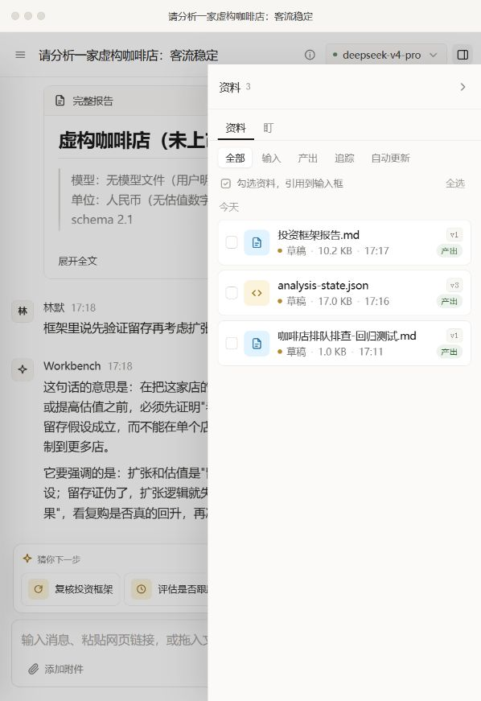

# 流式问答稳定性与按需文档生成修改报告

日期：2026-11-13（Asia/Shanghai）

分支：`fix/streaming-chat-jitter`

## 修改结果

流式回答在用户保持跟随状态时跟随最新内容，向上阅读时保持位置；首个 token 预留正文高度，正文更新复用已有节点，滚动条出现不再改变内容宽度。普通 QA 默认在聊天中回答，只有明确的文件交付请求或已授权的投资框架交付阶段才生成文档。

## 原因与实现

### 流式页面跳动

原有 `scheduleThread()` 默认要求滚动，每批 token 更新后都设置 `scrollTop = scrollHeight`，没有判断阅读位置。首 token 将隐藏正文显示出来，同时每次以完整 `innerHTML` 替换回答，Markdown 结构变化与强制置底共同造成位移。

- 增加 `follow` 滚动模式：维护显式跟随状态；上滑或拖动滚动条立即暂停，仅手动回到底部（1px 舍入容差）后恢复；显式 `true` 仍用于主动跳到底部，`false` 保留阅读位置。
- 同帧请求合并时保留较强的滚动意图，实际渲染时读取最新阅读位置。
- 对流式 Markdown 的匹配元素和文本节点原位更新，只有结构变化时替换节点；仍沿用原来的解析、清洗与引用链接链路。
- 为首行预留高度；使用稳定滚动条空间和明确的滚动控制。
- 快照刷新及 CopilotKit 完成/兜底交付使用跟随模式。CopilotKit 等待最终快照时保留实时正文，避免中间清空导致滚动位置被截断。

这不意味着所有 Markdown 块转换都不会改变高度；新增段落、标题和表格仍会自然增高。修复针对首行出现、滚动条出现及无条件抢占阅读位置等异常位移。

### 每轮 QA 自动生成报告

原系统提示要求所有“分析/报告类任务”都写入 Markdown 文件；model-qa 又直接继承投资框架技能，连带引入报告与状态交付要求。

新增共享 `DOCUMENT_OUTPUT_POLICY`，同时接入系统提示和每轮交互上下文，并收窄两份技能的交付边界：

- 普通问答、追问、解释、查数、分析、总结和自查：直接聊天回答。
- 明确要求写文档、生成报告、导出或保存文件：交付所需文件。
- 正在执行已授权的投资框架形成、更新或跟踪维护任务：遵循对应交付规则。
- 仅提到“报告/投资框架”、读取既有文档、历史上曾生成文档：不自动授权本轮落盘。
- “不要文档/只在聊天回答”优先；修改既有文档不额外生成一份 QA 报告。
- 查数、计算、事实登记、台账与内部缓存仍可正常工作。

当前实现是模型提示与技能规则约束，并非基于意图分类的工具层强制拦截。真实模型的本轮回归通过，但不代表所有未来表述都已覆盖。

## 修改文件

| 文件 | 用途 |
|---|---|
| `ui/chat/thread-scroll.js` | 共享滚动状态，识别用户操作并忽略程序滚动事件 |
| `ui/chat/renderer.js` | 跟随滚动、同帧意图合并、正文节点复用与阅读位置保留 |
| `styles.css` | 首行预留、滚动条空间、滚动锚定设置 |
| `ui/bootstrap.js` | 快照更新使用跟随滚动 |
| `ui/copilot-pilot/client.js` | 完成与兜底交付保留阅读位置，等待快照时保留实时正文 |
| `scripts/test-streaming-scroll-browser.py` | 真实浏览器布局与滚动回归脚本 |
| `lib/document-output-policy.mjs` | 新增共享文档输出规则 |
| `lib/turn-context.mjs` | 每轮问答注入输出规则 |
| `server/project-context.mjs` | 系统提示接入新规则并限定框架专属要求 |
| `skills/model-qa/SKILL.md` | 普通 QA 不继承框架文档交付要求 |
| `skills/investment-framework/SKILL.md` | 明确框架技能启用及文件交付边界 |

## 验证

### 自动化与模块回归

已通过：

- `node scripts/test-turn-context.mjs`
- `node scripts/test-post-answer.mjs`
- `node scripts/test-server-modules.mjs`（12 项）
- `node scripts/test-cell-cite-render.mjs`
- `node scripts/test-copilotkit.mjs`（35 项）
- `npm run test:presentation`
- `scripts/test-streaming-scroll-browser.py`（实际 Edge 浏览器，Playwright 驱动）
- 修改的 JavaScript 语法检查及 `git diff --check`

浏览器脚本覆盖首 token 高度与位置稳定、文本节点复用、大批量输出跟随、渲染前用户上滚、完成快照保留位置、逐字符 Markdown 渲染一致性、同帧滚动意图合并、滚动条出现时宽度稳定。运行前安装 Playwright；默认使用 Chromium，已有 Edge 可设置 `PE_BROWSER_CHANNEL=msedge`。

提交前已同步远程 main 的 DeepSeek Flash 模型限制，并重新通过以上模块测试与 Edge 浏览器回归。下面的六轮真实问答执行于同步之前的运行中服务，使用 deepseek-v4-pro；未将该结果声称为 Flash 的真实模型回归。

### 本地服务真实模型回归

通过页面新建项目「文档生成规则回归 1113」，在 `http://127.0.0.1:8081` 使用 `deepseek-v4-pro` 完成六轮真实问答，并核对持久化工具调用、每轮上下文与实际文件。测试使用虚构未上市咖啡店，不读取其他项目的研究资料。

项目 ID：`p-cb4b380a`

会话 ID：`f4a7dac5-91b0-44c9-a625-334dcdb10d4a`

| 轮次 | 场景 | 实际结果 |
|---|---|---|
| 1 | 普通经营分析，未附加“不生成文件”的提示 | 聊天回答，未调用写文件工具 |
| 2 | 明确要求将上轮内容保存为指定 Markdown | 一次 write，生成指定文档 |
| 3 | 文档生成后的解释与总结追问 | 聊天回答，无工具调用，不新增/修改文件 |
| 4 | 讨论投资框架，明确“只在聊天回答、不生成文档” | 聊天回答，无工具调用，不落盘 |
| 5 | 明确进入投资框架形成阶段并要求草稿交付 | 生成报告和状态文件；经修正后结构校验 0 error、11 warning |
| 6 | 框架交付后要求解释一句话 | 聊天回答，无工具调用，不新增/修改文件 |

每轮都已注入新文档输出规则。最终仅有三个预期文件：

- `exports/咖啡店排队排查-回归测试.md`
- `exports/咖啡店投资框架回归/analysis-state.json`
- `exports/咖啡店投资框架回归/投资框架报告.md`

流式过程上滚后的实测：`scrollTop` 保持约 555.33px，线程高度从 2,964px 增长至 6,208px，再到 13,538px，未被后续输出拉回底部。这验证了真实输出中阅读位置的保持；不等同于逐帧检测所有布局位移。

测试项目、会话和产出保留在本地，未将会话原始记录或测试项目数据纳入代码提交。

## 发现的限制与后续问题

本次文档生成边界验证通过，投资框架完整质量验收仍有独立问题：

- 首次状态文件不满足字段契约，模型经过多次修正才达到结构校验通过；本轮调用了 27 次工具，交付效率仍需改善。
- 最终 11 条警告：5 条 `PENDING_FALSIFIER_ARMED`、5 条 `OBSERVED_MISSING`、1 条 `VALUATION_SCENARIOS_MISSING`。
- 阈值待定却标为 `armed`，页面显示“跟踪中”，与实际尚不可触发的状态不一致；不能把所有警告都视为正常缺数据。
- 本轮仅产生草稿，未调用 `framework_commit`；没有验证版本化发布，不能将草稿称为已发布框架。
- 虚构定性案例没有验证事实、行情、财务数据或投资结论的正确性。

以上限制如实保留，不在本次修复中绕过校验或改写测试结果。

## 生效与回退

后端提示规则需重启服务加载，前端需刷新以加载新代码。真实回归的每轮记录已确认含新规则。回退本次提交可恢复原行为，不需要数据迁移；本地测试项目是独立新增数据。

## 补充修复：轻微上滑仍被拉回

初版以距底部 48px 内作为自动跟随条件，遗漏了轻微上滑场景。Edge 中已复现：上滑 24px 后 scrollTop 从 1798 被下一次更新强制改为 1855（底部）。另外，SSE 快照、run.started、CopilotKit 启动/停止以及追踪卡片仍有独立置底路径。

补充修复统一维护跟随状态，上滑滚轮、键盘与滚动条拖动暂停跟随；程序写入 scrollTop 的事件不会恢复用户已暂停的跟随。异步快照、生成阶段变化、停止/错误和自动追踪卡片改为尊重该状态；主动发送仍滚动到底部。快照暂时变短导致 scrollTop 被浏览器截断，也不会让后续 token 恢复抢占阅读位置。

浏览器回归增加轻微上滑、真实鼠标滚轮、滚动条操作期间的快照刷新、手动回底恢复跟随，以及短快照后继续输出场景。
